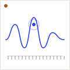
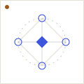

**[Portfolio ↗](https://kushwaha-aryan.github.io/resume/) · [LinkedIn ↗](https://www.linkedin.com/in/aryan-kushwaha-608204322/) · [LeetCode ↗](https://leetcode.com/u/dartGoblin42/) · [Email ↗](mailto:aryankushwaha9829@gmail.com)**

---

**01 / ABOUT**

## Strong fundamentals, *working output.*

I'm Aryan, a B.Tech Artificial Intelligence &amp; Machine Learning student at Birla Institute of Technology, Mesra (2024–2028). I'm aiming at a Software Development Engineer role, and the work I enjoy sits between clean data structures, reliable backend APIs and the judgement to choose the right tool.

I learn by finishing projects: a policy-gated payments agent, a locally running acoustic supervisor, a movie app with real accounts, and an agent workflow that keeps computed facts separate from generated advice. AI/ML is the second half of how I think about systems — I like models that behave predictably once they leave a notebook.

- **01 / DSA before frameworks** — Problem-solving is the base. I practise DSA to reason about complexity, not to memorise patterns.
- **02 / Backend that holds up** — REST APIs, authentication, persistence and clear contracts matter as much as the interface on top.
- **03 / AI with guardrails** — Models propose; deterministic rules decide. PayPilot's policy gate is the pattern I keep returning to.
- **04 / Finish and document** — A repository, a README and a working path from input to output are part of the project.

---

**02 / SELECTED PROJECTS**

## Work I can show, *not just describe.*

<table width="100%" cellpadding="0" cellspacing="0">
<tr>
<td width="50%" valign="top">

<table width="100%" cellpadding="0" cellspacing="0">
<tr>
<td width="80%" valign="top">
<b> 01 / AI AGENT · PAYMENTS</b> 
<a href="https://github.com/kushwaha-aryan/paypilot"><b>PayPilot</b></a> 
AI payment recovery and risk agent submitted to the PayPal AI Hackathon. Gemini proposes actions; a deterministic gate and human approval decide. Sandbox only. 
<code>Python</code> · <code>FastAPI</code> · <code>Gemini 3.1 Flash Lite</code> · <code>PayPal Sandbox</code> 
<a href="https://github.com/kushwaha-aryan/paypilot">Repository ↗</a> · Policy-gated flow
</td>
<td width="20%" valign="top" align="right">
 
<code>POLICY GATE</code>
</td>
</tr>
</table>

</td>
<td width="50%" valign="top">

<table width="100%" cellpadding="0" cellspacing="0">
<tr>
<td width="80%" valign="top">
<b> 02 / EDGE AI · AUDIO ML</b> 
<a href="https://github.com/kushwaha-aryan/edge-ai-acoustic-supervisor"><b>Edge AI Acoustic Supervisor</b></a> 
YAMNet → MLP across 17 mixed-source sound classes; 81.09% validation clip accuracy. Four software-simulated modes only. 
<code>Python</code> · <code>YAMNet</code> · <code>MLP</code> · <code>TensorFlow</code> 
<a href="https://github.com/kushwaha-aryan/edge-ai-acoustic-supervisor">Repository ↗</a> · Local prototype
</td>
<td width="20%" valign="top" align="right">
 
<code>17 CLASSES</code>
</td>
</tr>
</table>

</td>
</tr>
<tr>
<td width="50%" valign="top">

<table width="100%" cellpadding="0" cellspacing="0">
<tr>
<td width="80%" valign="top">
<b> 03 / FULL-STACK · MOVIES</b> 
<a href="https://github.com/kushwaha-aryan/movieV3"><b>MovieV3</b></a> 
Movie discovery with auth, watchlists, favorites, history, reviews and recommendations via a REST API. 
<code>JavaScript</code> · <code>Node.js</code> · <code>Express</code> · <code>MongoDB</code> 
<a href="https://github.com/kushwaha-aryan/movieV3">Repository ↗</a> · <a href="https://kushwaha-aryan.github.io/movieV3/">Live demo ↗</a>
</td>
<td width="20%" valign="top" align="right">
 
<code>WATCHLIST</code>
</td>
</tr>
</table>

</td>
<td width="50%" valign="top">

<table width="100%" cellpadding="0" cellspacing="0">
<tr>
<td width="80%" valign="top">
<b> 04 / AI AGENT · PORTFOLIO</b> 
<a href="https://github.com/kushwaha-aryan/AgenticAI"><b>AgenticAI</b></a> 
Multi-agent portfolio advisor that keeps computed facts separate from generated advice. 
<code>Python</code> · <code>Groq</code> · <code>LLM APIs</code> · <code>JavaScript</code> 
<a href="https://github.com/kushwaha-aryan/AgenticAI">Repository ↗</a> · Hackathon project
</td>
<td width="20%" valign="top" align="right">
 
<code>AGENT GRAPH</code>
</td>
</tr>
</table>

</td>
</tr>
<tr>
<td colspan="2" valign="top">

<table width="100%" cellpadding="0" cellspacing="0">
<tr>
<td width="80%" valign="top">
<b> 05 / ML · DATA</b> 
<a href="https://github.com/kushwaha-aryan/business-entity-resolution"><b>Business Entity Resolution</b></a> 
Links noisy business records across three sources using normalization, blocking keys and similarity features. 
<code>Python</code> · <code>Entity matching</code> · <code>Blocking</code> 
<a href="https://github.com/kushwaha-aryan/business-entity-resolution">Repository ↗</a> · Research project
</td>
<td width="20%" valign="top" align="right">
 
<code>RECORD CLUSTERS</code>
</td>
</tr>
</table>

</td>
</tr>
</table>

---

**03 / PROBLEM SOLVING**

## Consistent practice, *measurable progress.*

**600+** problems solved on LeetCode — [dartGoblin42 ↗](https://leetcode.com/u/dartGoblin42/).

---

**04 / TOOLKIT**

## The stack I *reach for.*

| Area | Tools |
|---|---|
| **Languages &amp; fundamentals** | C · C++ · Python · JavaScript · Java · DSA · OOP |
| **Backend &amp; APIs** | Node.js · Express · FastAPI · REST APIs · JWT auth · MongoDB · MySQL |
| **AI &amp; ML** | NumPy · pandas · scikit-learn · YAMNet · TensorFlow · Gemini API · Groq · Supervised learning |
| **Developer workflow** | Git · GitHub · pytest · OpenAPI docs · READMEs |

---

**05 / EDUCATION &amp; ACHIEVEMENTS**

## BIT Mesra, where the *fundamentals got serious.*

| Detail | |
|---|---|
| **Programme** | B.Tech, Artificial Intelligence &amp; Machine Learning · Birla Institute of Technology, Mesra |
| **Duration** | 2024 — 2028 |
| **CGPA** | 8.54/10 |
| **JEE Advanced 2024** | AIR 24,418 |
| **Graduation** | 2028 |

---

**06 / CERTIFICATIONS**

## Five courses, *with receipts.*

| Certification | Issuer |
|---|---|
| Machine Learning | DeepLearning.AI |
| Advanced Learning Algorithms | DeepLearning.AI |
| Supervised Machine Learning | DeepLearning.AI |
| Unsupervised Learning &amp; Recommenders | DeepLearning.AI |
| Python | Kaggle |

---

**07 / CONTACT**

## Open to software engineering *roles and internships.*

> If you're looking for a student engineer who cares about DSA, backend fundamentals and finishing the work, I'd like to hear from you.

**[Email ↗](mailto:aryankushwaha9829@gmail.com) · [LinkedIn ↗](https://www.linkedin.com/in/aryan-kushwaha-608204322/) · [Portfolio ↗](https://kushwaha-aryan.github.io/resume/) · [GitHub ↗](https://github.com/kushwaha-aryan)**

---

*Built from scratch. No testimonials or invented metrics here.*

