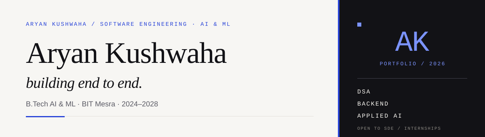
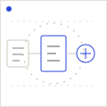
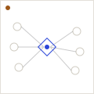

**[Portfolio ↗](https://kushwaha-aryan.github.io/resume/) · [LinkedIn ↗](https://www.linkedin.com/in/aryan-kushwaha-608204322/) · [LeetCode ↗](https://leetcode.com/u/dartGoblin42/) · [Email ↗](mailto:aryankushwaha9829@gmail.com)**

---

**01 / ABOUT**

## Strong fundamentals, *working output.*

I'm Aryan, a B.Tech Artificial Intelligence &amp; Machine Learning student at Birla Institute of Technology, Mesra (2024–2028). I'm aiming at a Software Development Engineer role, and the work I enjoy sits between clean data structures, reliable backend APIs and the judgement to choose the right tool.

I learn by finishing projects: a policy-gated payments agent, a locally running acoustic supervisor, a movie app with real accounts, and an agent workflow that keeps computed facts separate from generated advice. AI/ML is the second half of how I think about systems — I like models that behave predictably once they leave a notebook.

- **01 / DSA before frameworks** — Problem-solving is the base. I practise DSA to reason about complexity, not to memorise patterns.
- **02 / Backend that holds up** — REST APIs, authentication, persistence and clear contracts matter as much as the interface on top.
- **03 / AI with guardrails** — Models propose; deterministic rules decide. PayPilot's policy gate is the pattern I keep returning to.
- **04 / Finish and document** — A repository, a README and a working path from input to output are part of the project.

---

**02 / SELECTED PROJECTS**

## Work I can show, *not just describe.*

<table cellpadding="0" cellspacing="0">
<tr>
<td width="50%" valign="top">

<table cellpadding="0" cellspacing="0">
<tr>
<td width="68%" valign="top">

>  **01 / AI AGENT · PAYMENTS**
> ### [PayPilot](https://github.com/kushwaha-aryan/paypilot)
> AI payment recovery and risk agent submitted to the PayPal AI Hackathon. Gemini proposes structured actions; a deterministic policy gate and human approval decide what may execute. PayPal Sandbox only — not production payment processing.
>
> `Python` · `FastAPI` · `Gemini 3.1 Flash Lite` · `PayPal Sandbox REST APIs`
>
> [Repository ↗](https://github.com/kushwaha-aryan/paypilot) · Policy-gated flow

</td>
<td width="32%" valign="top">

`POLICY GATE`

</td>
</tr>
</table>

</td>
<td width="50%" valign="top">

<table cellpadding="0" cellspacing="0">
<tr>
<td width="68%" valign="top">

>  **02 / EDGE AI · AUDIO ML**
> ### [Edge AI Acoustic Supervisor](https://github.com/kushwaha-aryan/edge-ai-acoustic-supervisor)
> Locally running audio classifier and supervisor. YAMNet audio embeddings feed an MLP classifier across 17 sound classes from mixed public datasets; approximately 81.09% validation clip accuracy. Four software-simulated audio modes, with no earbud or ANC hardware integration.
>
> `Python` · `YAMNet` · `MLP` · `TensorFlow` · `scikit-learn`
>
> [Repository ↗](https://github.com/kushwaha-aryan/edge-ai-acoustic-supervisor) · Local prototype

</td>
<td width="32%" valign="top">

`17 CLASSES`

</td>
</tr>
</table>

</td>
</tr>
<tr>
<td width="50%" valign="top">

<table cellpadding="0" cellspacing="0">
<tr>
<td width="68%" valign="top">

>  **03 / FULL-STACK · MOVIES**
> ### [MovieV3](https://github.com/kushwaha-aryan/movieV3)
> Movie discovery platform with authentication, watchlists, favorites, watched history, reviews and recommendations, backed by a REST API.
>
> `JavaScript` · `Node.js` · `Express` · `MongoDB` · `REST API`
>
> [Repository ↗](https://github.com/kushwaha-aryan/movieV3) · [Live demo ↗](https://kushwaha-aryan.github.io/movieV3/)

</td>
<td width="32%" valign="top">

`WATCHLIST VIEW`

</td>
</tr>
</table>

</td>
<td width="50%" valign="top">

<table cellpadding="0" cellspacing="0">
<tr>
<td width="68%" valign="top">

>  **04 / AI AGENT · PORTFOLIO**
> ### [AgenticAI](https://github.com/kushwaha-aryan/AgenticAI)
> Hackathon project exploring a multi-agent portfolio advisor that keeps computed facts separate from generated advice.
>
> `Python` · `Groq` · `LLM APIs` · `JavaScript`
>
> [Repository ↗](https://github.com/kushwaha-aryan/AgenticAI) · Hackathon project

</td>
<td width="32%" valign="top">

`AGENT GRAPH`

</td>
</tr>
</table>

</td>
</tr>
<tr>
<td colspan="2" valign="top">

<table cellpadding="0" cellspacing="0">
<tr>
<td width="68%" valign="top">

>  **05 / ML · DATA**
> ### [Business Entity Resolution](https://github.com/kushwaha-aryan/business-entity-resolution)
> Research project linking noisy business records across three sources using normalization, blocking keys, similarity features and a staged evaluation pipeline.
>
> `Python` · `Data processing` · `Entity matching` · `Blocking`
>
> [Repository ↗](https://github.com/kushwaha-aryan/business-entity-resolution) · Research project

</td>
<td width="32%" valign="top">

`RECORD CLUSTERS`

</td>
</tr>
</table>

</td>
</tr>
</table>

---

**03 / PROBLEM SOLVING**

## Consistent practice, *measurable progress.*

**600+** problems solved on LeetCode — [dartGoblin42 ↗](https://leetcode.com/u/dartGoblin42/).

---

**04 / TOOLKIT**

## The stack I *reach for.*

| Area | Tools |
|---|---|
| **Languages &amp; fundamentals** | C · C++ · Python · JavaScript · Java · DSA · OOP |
| **Backend &amp; APIs** | Node.js · Express · FastAPI · REST APIs · JWT auth · MongoDB · MySQL |
| **AI &amp; ML** | NumPy · pandas · scikit-learn · YAMNet · TensorFlow · Gemini API · Groq · Supervised learning |
| **Developer workflow** | Git · GitHub · pytest · OpenAPI docs · READMEs |

---

**05 / EDUCATION &amp; ACHIEVEMENTS**

## BIT Mesra, where the *fundamentals got serious.*

| Detail | |
|---|---|
| **Programme** | B.Tech, Artificial Intelligence &amp; Machine Learning · Birla Institute of Technology, Mesra |
| **Duration** | 2024 — 2028 |
| **CGPA** | 8.54/10 |
| **JEE Advanced 2024** | AIR 24,418 |
| **Graduation** | 2028 |

---

**06 / CERTIFICATIONS**

## Five courses, *with receipts.*

| Certification | Issuer |
|---|---|
| Machine Learning | DeepLearning.AI |
| Advanced Learning Algorithms | DeepLearning.AI |
| Supervised Machine Learning | DeepLearning.AI |
| Unsupervised Learning &amp; Recommenders | DeepLearning.AI |
| Python | Kaggle |

---

**07 / CONTACT**

## Open to software engineering *roles and internships.*

> If you're looking for a student engineer who cares about DSA, backend fundamentals and finishing the work, I'd like to hear from you.

**[Email ↗](mailto:aryankushwaha9829@gmail.com) · [LinkedIn ↗](https://www.linkedin.com/in/aryan-kushwaha-608204322/) · [Portfolio ↗](https://kushwaha-aryan.github.io/resume/) · [GitHub ↗](https://github.com/kushwaha-aryan)**

---

*Built from scratch. No testimonials or invented metrics here.*

